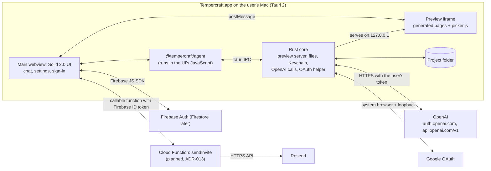

# Architecture overview

| Field | Value |
|---|---|
| Document ID | ARCH-001 |
| Product or service | Tempercraft desktop app (macOS) and its external services |
| Owner | Project owner |
| Reviewers | None assigned yet (single-maintainer project) |
| Status | Draft |
| Version | 10 |
| Last reviewed | 2026-11-21 |
| Review trigger | When system boundaries, dependencies, infrastructure, or major quality requirements change |
| Related work | [Decisions and risks](#decisions-and-risks), [authentication design](authentication.md), [agent design](agent.md), [developer guide](../engineering/developer-guide.md) |

## Goals, constraints, and context

- **Status (2026-11-21):** only the shell exists, a Tauri 2 app with the Solid 2.0 template UI. *Planned* marks agreed design that isn't code yet.
- **System boundary:** a desktop app on the user's Mac. It talks to OpenAI (sign-in and the Responses API), Google OAuth and Firebase. A planned Cloud Function sends invite emails through Resend ([ADR-013](../adr/ADR-013-transactional-email-resend.md)).
- **Users:** people designing web pages by chatting with an agent. The first release is invite-only, for teams ([DEC-001](../product/decisions.md#decisions); [user journey](../user-journeys/JOURNEY-001-invite-to-dashboard.md)).
- **Quality requirements:**
  - Low memory use ([ADR-001](../adr/ADR-001-desktop-shell-tauri-2.md)).
  - Streaming replies that update cheaply ([ADR-002](../adr/ADR-002-ui-framework-solid-2.md)).
  - User tokens never leave the Rust core and the Keychain.
  - Generated code is treated as untrusted.
- **Constraints:**
  - The app is open source, so it holds no secrets ([ADR-003](../adr/ADR-003-free-and-open-source.md)).
  - Model calls follow Sign in with ChatGPT's rules and never pass through a Tempercraft server ([ADR-004](../adr/ADR-004-model-access-sign-in-with-chatgpt.md)).
- **Requirements:** there's no PRD or nonfunctional requirements document yet ([register gaps](../README.md#gaps-and-actions)).

## Architecture views

### Context and containers



Model calls go from the Mac straight to OpenAI, and there's no Tempercraft server for them. Firebase handles the Google sign-in, and a planned Cloud Function sends invite emails through Resend.

### One turn, step by step *(planned)*

1. The user types a request, optionally after picking an element in the preview.
2. The UI hands the agent the conversation so far, the request and the selection.
3. The agent builds a Responses API request containing:
   - `instructions` from `prompts/system.md`
   - the full history as `input`
   - its function tools
   - `store: false` and `stream: true`
4. The UI's `ModelClient` passes the request to a Rust command, which:
   - adds the user's access token from the Keychain, refreshing it first if it's about to expire
   - POSTs to `https://api.openai.com/v1/responses`
   - streams the events back over a Tauri channel
5. Text deltas stream into the chat. Tool calls (list, read and edit files) go through `Workspace`, which is a set of Rust commands limited to the project folder.
6. Rust's file watcher sees the edit, and the preview iframe reloads.
7. The turn ends on `response.completed`. A `response.failed` with a usage-limit code shows the "Manage usage" prompt (see [calling the model](authentication.md#calling-the-model)).

### Preview and element picker *(planned)*

- **Serving:** the Rust core serves the project folder over HTTP on `127.0.0.1`, on a random port, under a random path prefix ([ADR-010](../adr/ADR-010-preview-iframe-loopback.md)).
  - Pages behave as they would on a real site: relative URLs, `fetch` and modules all work.
  - "Open in browser" can use the same URL.
- **Injection:** when it serves HTML, the server:
  - injects `<script src="…/picker.js">`
  - stamps each element with its source location (`data-tc-loc="index.html:42"` or similar), so a click maps straight to `file:line`
- **Isolation:** the iframe's origin (`http://127.0.0.1:<port>`) differs from the app's, so the page's scripts can't reach the app, its IPC or any token.
- **Why an iframe rather than a second native webview:** Tauri 2.12 still gates child webviews (`Window::add_child`) behind its `unstable` feature. An iframe also works the same way in any shell.

## Components and dependencies

| Component | Responsibility | Interface | Data owned | Runtime or technology | Owner |
|---|---|---|---|---|---|
| Main webview (`apps/desktop/src/`) | The UI: chat, preview pane, settings, sign-in screens. Runs the agent loop. Never holds OpenAI tokens | Tauri IPC to the Rust core, `postMessage` to the preview, the Firebase JS SDK | UI state and the Firebase session | Solid 2.0 on Vite 8 ([ADR-002](../adr/ADR-002-ui-framework-solid-2.md)); pinned by the lockfile | Project owner |
| Rust core (`apps/desktop/src-tauri/`) | Everything privileged: the preview server, project-folder access, the file watcher, the Keychain, HTTPS calls to OpenAI (with token refresh), and the OAuth helper for both sign-ins | Tauri commands and channels | OpenAI and Google tokens (in the Keychain) and the installation's host ID | Rust, Tauri 2.12 ([ADR-001](../adr/ADR-001-desktop-shell-tauri-2.md)) | Project owner |
| Preview | Shows the project's pages | An iframe in the main webview, loaded from the preview server on `127.0.0.1` | — | [ADR-010](../adr/ADR-010-preview-iframe-loopback.md) | Project owner |
| Picker *(planned)* (`apps/desktop/preview-runtime/`) | `picker.js`, injected into every page. Highlights the element under the cursor and reports the clicked one | `postMessage` ([data and contracts](#data-and-contracts)) | — | Plain JavaScript | Project owner |
| Agent (`packages/agent/`) | Instructions, tools and loop. Model access and file access are passed in, so promptfoo can run it headless | `AgentHost` in `src/index.ts` ([agent design](agent.md)) | The conversation, in memory | TypeScript with no Tauri, Solid or Node imports ([ADR-006](../adr/ADR-006-headless-agent-package.md)) | Project owner |
| Firebase (`firebase/`) | Google sign-in through Firebase Auth. Firestore and Storage rules exist but deny everything, and nothing uses them yet | Firebase JS SDK | User accounts | Firebase projects `tempercraft-dev` (dev) and `tempercraft` (prod), on Blaze ([ADR-012](../adr/ADR-012-firebase-blaze-plan.md), [ADR-014](../adr/ADR-014-dev-and-prod-firebase-projects.md)). Auth to be upgraded to Identity Platform ([ADR-019](../adr/ADR-019-block-sign-up-without-invite.md)) | Project owner |
| Invite function *(planned)* | Sends invite emails after checking the caller's identity and role | Firebase callable function | Invites; not designed yet | Cloud Functions with Resend ([ADR-013](../adr/ADR-013-transactional-email-resend.md)) | Project owner |
| OpenAI (external) | Sign in with ChatGPT and the Responses API | OAuth with PKCE on `auth.openai.com`; HTTPS to `api.openai.com/v1` | The user's ChatGPT account | [ADR-004](../adr/ADR-004-model-access-sign-in-with-chatgpt.md) | OpenAI |
| Google OAuth (external) | The Google sign-in that Firebase accepts | OAuth 2.0 for desktop apps | The user's Google account | [ADR-008](../adr/ADR-008-google-sign-in-firebase-system-browser.md) | Google |
| Sentry (external, planned) | Errors, crashes and performance, from the site and the app | Sentry SDKs; the DSN is public by design | Error events, scrubbed of personal data | [ADR-016](../adr/ADR-016-sentry-error-tracking.md) | Sentry |
| Google Analytics (external, planned) | Usage analytics for the site and the app | The GA4 tag on the site; the Measurement Protocol through a Cloud Function for the app | Usage events | [ADR-017](../adr/ADR-017-google-analytics.md) | Google |

### Repository layout

```
tempercraft-app/
├── apps/
│   └── desktop/                Tauri 2 app (npm workspace @tempercraft/desktop)
│       ├── src/                Solid 2.0 UI
│       ├── src-tauri/          Rust core (crate `tempercraft`)
│       └── preview-runtime/    planned: picker.js and friends
├── packages/
│   └── agent/                  design agent (npm workspace @tempercraft/agent)
│       ├── prompts/system.md   system instructions, first draft
│       ├── src/index.ts        contract with the host
│       └── evals/              planned: promptfoo tests and red team
├── firebase/                   Firestore and Storage rules, indexes
├── docs/                       this documentation
├── firebase.json, .firebaserc  Firebase CLI config (paths point into firebase/)
└── package.json                npm workspaces: apps/*, packages/*
```

- **One top-level folder per thing that ships or deploys:** the app, the Firebase config, the agent library ([ADR-011](../adr/ADR-011-monorepo-npm-workspaces.md)). A future `apps/web/` would hold the tempercraft.app site: the landing and download page, the invite accept page, and the privacy policy.
- **`firebase.json` stays at the root.** The Firebase CLI looks for it in the current folder and every folder above, so `firebase` commands work from anywhere in the repo.
- **No Cloud Functions folder yet.** Functions are allowed now ([ADR-012](../adr/ADR-012-firebase-blaze-plan.md)). The first one gets its own folder and a `functions` entry in `firebase.json`.

## Data and contracts

- **Agent contract:** `AgentHost` passes `instructions`, a `ModelClient` and a `Workspace`. A `Selection` describes the picked element: file, line, selector, `outerHTML`, a few computed styles and its rectangle. See the [agent design](agent.md#high-level-design).
- **Model requests:** Responses API with `store: false` and `stream: true`, the full history every turn, and instructions in the `instructions` field ([calling the model](authentication.md#calling-the-model)).
- **Picker messaging:** both sides check who sent each message.
  - UI to picker: `pick:start`, `pick:stop`.
  - Picker to UI: `pick:selected` with a `Selection`, and `page:error` with console errors so the agent can fix them.
- **Tauri IPC:** `Workspace` commands are limited to the project folder, and the model command streams events over a Tauri channel. Command names aren't defined yet.
- **Firebase data:** none yet, and the rules deny all reads and writes. The orgs, invites, roles and projects in the [user journeys](../user-journeys/JOURNEY-001-invite-to-dashboard.md) need a data model and rules first. Each org is a tenant with one team ([DEC-006](../product/decisions.md#decisions)), so data and rules are partitioned by org. Each org also lists its email domains, which are verified by DNS and unique across orgs, and accounts can be paused ([DEC-007](../product/decisions.md#decisions), [DEC-010](../product/decisions.md#decisions)).
  - **Proposed separation,** to detail in the data and authorization models:
    - Each org's records live under `orgs/{orgId}`: members (role and status), invites, domains and the audit log.
    - A top-level `domains` collection maps each domain to its one org.
    - The security rules let a signed-in user reach an org's records only while their member record there is active.
    - Changes to members, roles, invites and domains happen only in server functions.
    - Rules tests in the emulator prove that one org can't read or write another's.
- **Tokens:** one Keychain record per issued ChatGPT client ID and account ([authentication design](authentication.md#session-contract)).
- **Project files:** the user's project folder on the Mac is the only copy of their designs. Tempercraft doesn't upload it anywhere. File contents and screenshots go to OpenAI only as part of the conversation.
- **Links into the app:** `tempercraft://open` opens the release app, and `tempercraft-dev://` opens the dev app. The website's `/open` page hands off to them ([ADR-018](../adr/ADR-018-open-app-from-browser.md)).

## Reliability and failure behavior

- **Model turns:** a turn has succeeded only when `response.completed` arrives. The app also handles `response.incomplete`, interrupted streams and `response.failed`, including usage-limit codes that can arrive mid-stream ([calling the model](authentication.md#calling-the-model)).
- **Tokens:** the Rust core refreshes an access token near expiry and runs one refresh at a time per account, so a rotating refresh token is never used twice.
- **Preview:** the file watcher reloads the iframe after each edit, and page errors flow back to the agent through `page:error`.
- **Edits:** the agent replaces exact snippets (`edit_file`) to keep changes small. Undo and version history for agent edits aren't designed yet.
- **Backup and recovery:** there's no server-side data yet; designs live in the user's own folder. Recovery objectives are N/A until Firestore holds data.

## Environments, delivery, and observability

- **Environments** ([ADR-014](../adr/ADR-014-dev-and-prod-firebase-projects.md)):

  | Environment | Firebase project | State on 2026-11-21 |
  | --- | --- | --- |
  | Local | `demo-tempercraft`, emulators only | `npm run emulators` |
  | Dev | `tempercraft-dev` | `(default)` Firestore database in `australia-southeast1` with deny-all rules; web app registered; Google sign-in not set up |
  | Prod | `tempercraft` | No Firestore database or web app yet |

  The app picks dev or prod by build mode. Functions run in `australia-southeast1`. The website is each project's Hosting site, at `dev.tempercraft.app` and `tempercraft.app` ([ADR-015](../adr/ADR-015-website-hosting-and-urls.md)).
- **Delivery:** `npm run build` produces the app bundle. Universal builds, signing and notarization, the updater and the CSP must be done [before the first release](../engineering/developer-guide.md#before-the-first-release). Firebase rules deploy with the Firebase CLI.
- **Configuration and secrets:**
  - The Firebase web config (`apiKey`, `projectId` and so on) only identifies the project. It isn't a secret and can live in the repo.
  - The app holds no secrets. Server-side secrets go in Secret Manager ([ADR-012](../adr/ADR-012-firebase-blaze-plan.md)), and user tokens go in the macOS Keychain.
- **Observability:** nothing is set up yet. Sentry will report errors, crashes and performance from the site and the app ([ADR-016](../adr/ADR-016-sentry-error-tracking.md)). Google Analytics will measure usage, with the app's events sent through a Cloud Function ([ADR-017](../adr/ADR-017-google-analytics.md)). Tokens, prompts, file contents and email addresses never go into either.

## Capacity, security, and cost

- **Demand:** each user's model usage runs on their own ChatGPT plan. ChatGPT Plus has a five-hour usage limit shared by every app that uses the plan; Pro doesn't. Tempercraft has no model costs of its own.
- **Cost drivers:**
  - Firebase on Blaze beyond the no-cost quotas. A budget alert isn't confirmed yet ([register gaps](../README.md#gaps-and-actions)).
  - Resend's free plan, up to 100 emails a day ([ADR-013](../adr/ADR-013-transactional-email-resend.md)).
  - Apple Developer Program membership for signing, US$99 a year.
  - Evals, which run on the developer's own OpenAI API key.
- **Threat model:** not written yet. Add one before the first release; until then, the rules below and the [authentication design](authentication.md) define the trust boundaries.

### Security rules

- **Tokens:** OpenAI and Google tokens live only in the Rust core and the macOS Keychain. They never go into the webview's storage, logs, URLs, analytics or the model's context. OpenAI's Sign in with ChatGPT docs require keeping tokens out of browser storage.
- **Files:** the agent can only touch the project folder. Rust enforces this by canonicalizing every path and rejecting anything outside the folder, including symlinks that lead out of it.
- **No shell or network tools** for the agent.
- **Generated code is untrusted:** it runs in the cross-origin iframe, and every `postMessage` is checked.
- **Prompt injection:**
  - The agent's instructions tell it to treat page text, files and selections as data, and promptfoo tests that (see the [agent design](agent.md)).
  - The real guarantees are the code-level rules above ([ADR-007](../adr/ADR-007-promptfoo-hardening-code-guarantees.md)).
- **CSP:** the Tauri template ships `"csp": null`. Set a real Content-Security-Policy before the first release, allowing the preview origin in `frame-src` and Firebase in `connect-src`.
- **Firebase rules** deny all reads and writes until we add data.
- **Server-side functions** verify the caller's Firebase identity and role, and rate-limit ([ADR-012](../adr/ADR-012-firebase-blaze-plan.md)).
- **Links into the app** are untrusted input. The app checks each one against its known list, and links never carry tokens or invite codes ([ADR-018](../adr/ADR-018-open-app-from-browser.md)).

## Decisions and risks

| Decision or risk | Alternatives or mitigation | Rationale and evidence | ADR or work item | Owner |
|---|---|---|---|---|
| Tauri 2 desktop shell | Electron, native SwiftUI, Electrobun | Smaller app and less memory than shipping Chromium | [ADR-001](../adr/ADR-001-desktop-shell-tauri-2.md) | Project owner |
| Solid 2.0 UI | React, Solid 1.x | Fine-grained updates for streamed replies; small runtime | [ADR-002](../adr/ADR-002-ui-framework-solid-2.md) | Project owner |
| Free and open source | Paid subscription | Lets users bring their ChatGPT plan without partner approval | [ADR-003](../adr/ADR-003-free-and-open-source.md) | Project owner |
| Sign in with ChatGPT, called from the Mac | Codex login, `backend-api`, our own proxy | Documented for open-source, locally hosted apps | [ADR-004](../adr/ADR-004-model-access-sign-in-with-chatgpt.md) | Project owner |
| Our own headless agent | Embedding `codex app-server` | A small, testable toolset | [ADR-005](../adr/ADR-005-own-agent-not-codex.md), [ADR-006](../adr/ADR-006-headless-agent-package.md) | Project owner |
| Limits enforced in code and measured with promptfoo | Instructions alone | Only code can guarantee limits | [ADR-007](../adr/ADR-007-promptfoo-hardening-code-guarantees.md) | Project owner |
| Google sign-in through Firebase, in the system browser | Popup (blocked by Google); Sign in with ChatGPT only (open) | Google blocks OAuth in embedded webviews | [ADR-008](../adr/ADR-008-google-sign-in-firebase-system-browser.md) | Project owner |
| Preview iframe on `127.0.0.1` | A child webview (unstable in Tauri 2.12) | Origin isolation in any shell | [ADR-010](../adr/ADR-010-preview-iframe-loopback.md) | Project owner |
| One repo with npm workspaces | Turborepo or Nx; separate repos | One developer; atomic changes | [ADR-011](../adr/ADR-011-monorepo-npm-workspaces.md) | Project owner |
| Firebase on Blaze, with functions for server-side work | Spark ([ADR-009](../adr/ADR-009-firebase-spark-no-cloud-functions.md), superseded) | Invite emails need server-side code | [ADR-012](../adr/ADR-012-firebase-blaze-plan.md) | Project owner |
| Invite emails through Resend | Mailgun, SendGrid, Workspace SMTP, Cloudflare Email Service, Amazon SES | Free at invite volumes; no credential in the app | [ADR-013](../adr/ADR-013-transactional-email-resend.md) | Project owner |
| Separate Firebase projects for dev and prod | Two databases in one project; emulators only | Firebase's recommendation; Auth, functions and secrets are per project | [ADR-014](../adr/ADR-014-dev-and-prod-firebase-projects.md) | Project owner |
| Website on Firebase Hosting at `tempercraft.app` and `dev.tempercraft.app` | Cloudflare Pages; App Hosting | Same project as each environment's functions, so no CORS | [ADR-015](../adr/ADR-015-website-hosting-and-urls.md) | Project owner |
| Sentry for errors and observability | Platform logs only | One tool for the site and the app | [ADR-016](../adr/ADR-016-sentry-error-tracking.md) | Project owner |
| Google Analytics, with the app's events sent through a Cloud Function | The GA tag inside the app; the secret inside the app | Google keeps the Measurement Protocol secret private | [ADR-017](../adr/ADR-017-google-analytics.md) | Project owner |
| A `tempercraft://` URL scheme to open the app | Firebase Dynamic Links (shut down); universal links (iOS only in Tauri) | Works on macOS today | [ADR-018](../adr/ADR-018-open-app-from-browser.md) | Project owner |
| Block sign-up without an invite, with a blocking function | A check after sign-in | No stray accounts for people who weren't invited | [ADR-019](../adr/ADR-019-block-sign-up-without-invite.md) | Project owner |
| Risk: the template's CSP is `null` | Set a real CSP before the first release | Generated pages run next to the app | [Developer guide](../engineering/developer-guide.md#before-the-first-release) | Project owner |
| Risk: WebKit renders differently from other browsers | Revisit the shell if it hurts users' designs | — | [ADR-001](../adr/ADR-001-desktop-shell-tauri-2.md) | Project owner |
| Risk: Sign in with ChatGPT plan usage is a preview | Revisit if OpenAI changes its terms | — | [ADR-004](../adr/ADR-004-model-access-sign-in-with-chatgpt.md) | Project owner |
| Risk: public functions can be abused | Identity and role checks, rate limits, a budget alert | The Firebase config in an open-source app is public | [ADR-012](../adr/ADR-012-firebase-blaze-plan.md) | Project owner |

## C4 and policy boundaries

- **View type:** the diagram in [context and containers](#context-and-containers) is a container-level view. It shows the app's containers (main webview, agent, preview, Rust core, project folder) and the external systems.
- **Element IDs:** the Mermaid node IDs: `ui`, `agent`, `preview`, `core`, `folder`, `openai`, `google`, `firebase`, `invite`, `resend`.
- **Not written yet:** a separate C4 view set, a Clean Architecture design and a threat model. The code is a scaffold with one maintainer, and the trust boundaries are covered by the [security rules](#security-rules) and the [authentication design](authentication.md). Add the threat model before the first release.

## Completion check

- [x] System boundaries, data ownership, dependencies, and deployment are understandable.
- [ ] Failure handling and quality requirements have design responses.
- [x] Important choices and unresolved risks link to decisions or work items.
